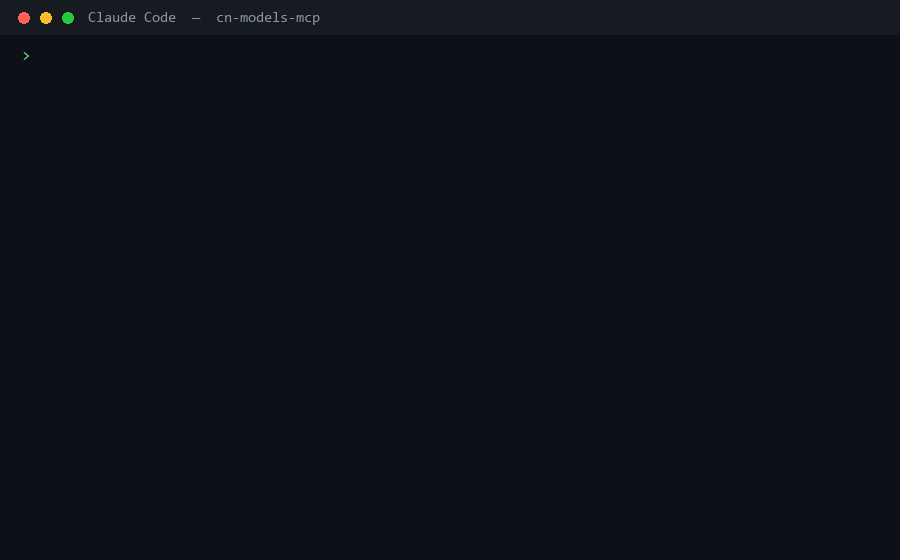

# cn-models-mcp

> 让你的 Claude Code / Cursor / Cline 多一个「便宜的第二意见」—— 一句话调用 DeepSeek、Kimi、GLM、通义千问。
> 支付宝充值即可，**不需要海外信用卡，不需要 VPN**。

[](https://modelcontextprotocol.io)
[](https://github.com/xiexingye/cn-models-mcp/actions/workflows/publish.yml)
[](https://nodejs.org)
[](LICENSE)
[](#支持的模型)

---

## 30 秒看懂它解决什么



*（上图是真实录制的调用：`58↓ 365↑ tokens · ¥0.0015` —— 数字来自厂商返回的真实用量，不是编的）*

你在 Claude Code 里问「这个正则为什么匹配不到」，Opus 5.5 给你答案，账单 +¥3。

同样的问题，**DeepSeek 花 ¥0.0015，答案足够好**。

这个 MCP server 把四家国内模型接进你的 Agent，于是你可以：

```
你：用 deepseek 看看这个报错怎么回事，给个第二意见
Claude Code：→ 调用 cn-models-mcp 的 ask 工具 → ¥0.0015
             [DeepSeek 的回答]
             → 我判断它的结论正确，补充一点……
```

**它不替换你的主模型，它给你的主模型配了一个廉价的下手。**


## 成本差距（真实数字，非估算口号）

同一份工作量（500 万输入 + 200 万输出 token ≈ 一个月的日常编码助手用量）：

| 模型 | 花费 | 相对 Opus 5.5 |
| --- | --- | --- |
| `glm-5.3-flash` | **¥6.5** | **1/70** |
| `deepseek-flash` | ¥26 | 1/18 |
| `kimi-k3` / `glm-5.3` | ¥52 | 1/9 |
| `deepseek-v4-pro` | ¥99 | 1/4.6 |
| Claude Opus 5.5（对照） | ¥456 | 1× |

完整表格（三种用量档位、含闲时/高峰价）见 **[docs/pricing.md](docs/pricing.md)** —— 由 `npm run pricing` 从模型注册表自动生成，不接受手工维护，所以数字不会烂掉。

> 价格核对日期 2026-10-12，来源为各厂商定价页。厂商调价 → 改 `src/model-registry.mjs` 一处即可，README 数字自动跟着变。

## 快速开始（两分钟）

### 1. 拿一个密钥（任选一家，都支持支付宝）

| 厂商 | 申请地址 | 备注 |
| --- | --- | --- |
| **DeepSeek** | [platform.deepseek.com/api_keys](https://platform.deepseek.com/api_keys) | 最省事，充值 10 元能用很久 |
| Kimi / Moonshot | [platform.kimi.com](https://platform.kimi.com/console/api-keys) | 长上下文强 |
| 智谱 GLM | [bigmodel.cn](https://bigmodel.cn/usercenter/proj-mgmt/apikeys) | 有极便宜的 Flash 档 |
| 通义千问 | [阿里云百炼](https://bailian.console.aliyun.com/) | 代码能力好 |

### 2. 装进你的 MCP 客户端

**Claude Code** —— 编辑 `~/.claude.json`（或项目里的 `.mcp.json`），加：

```json
{
  "mcpServers": {
    "cn-models": {
      "command": "npx",
      "args": ["-y", "cn-models-mcp"],
      "env": { "DEEPSEEK_API_KEY": "sk-你的密钥" }
    }
  }
}
```

<details>
<summary>装不上 npm？用 git 直装（不需要 npm 账号，走 github.com）</summary>

把 `args` 里的包名换成 git 地址即可：

```json
{
  "mcpServers": {
    "cn-models": {
      "command": "npx",
      "args": ["-y", "github:xiexingye/cn-models-mcp"],
      "env": { "DEEPSEEK_API_KEY": "sk-你的密钥" }
    }
  }
}
```

或全局安装：`npm i -g github:xiexingye/cn-models-mcp`

**为什么这条能救命**：它走 `github.com` 与 `codeload`，**完全不经过 npm registry 与 npmjs.com**。已实测：`npm install <git 仓库>` 能正确装出包并注册 `bin`。

</details>

**Cursor** —— `~/.cursor/mcp.json`，结构同上。

**Cline / VS Code** —— 在 MCP 设置面板粘贴同一段 JSON。


> 💡 不想把密钥写进配置文件？写 `~/.cn-models-mcp.json` 就行（只放密钥，不带其他字段），配置文件里的 `env` 可以整个省掉：
>
> ```json
> { "DEEPSEEK_API_KEY": "sk-..." }
> ```
>
> 加载优先级：**真实环境变量 > `~/.cn-models-mcp.json` > 项目 `.env`**。

### 3. 验证

重启客户端后在对话里说：

> **「调用 check_setup 看看配置好了没」**

它会逐个厂商报告密钥状态（**密钥只显示前 6 位**）并告诉你下一步。也可以在终端直接跑：

```bash
node src/doctor.mjs
```

> ⚠️ 需要 **Node ≥ 20**（MCP SDK v2 要求）。本仓库的源码直接可跑，无需编译。

## 兼容性：哪些客户端能装

本 server 同时提供两种传输，**默认 stdio**：

| 客户端 | stdio | HTTP | 能否使用 | 配置备注 |
| --- | :---: | :---: | :---: | --- |
| **Claude Code** | ✅ | ✅ | ✅ | `~/.claude.json` 或项目 `.mcp.json` |
| **Claude Desktop** | ✅ | ✅ | ✅ | `claude_desktop_config.json` |
| **Cursor** | ✅ | ✅ | ✅ | `~/.cursor/mcp.json` |
| **Cline** / **Continue** | ✅ | — | ✅ | VS Code 扩展，走 MCP 设置面板 |
| **Windsurf** | ✅ | ✅ | ✅ | ⚠️ 字段是 `serverUrl`，**不是** `url` |
| **Zed** | ✅ | ✅ | ✅ | ⚠️ 配置键是 `context_servers`，**不是** `mcpServers` |
| **Gemini Code Assist** | ✅ | ✅ | ✅ | `mcp.json`（IntelliJ / VS Code） |
| **Trae CN**（字节） | ✅ | ✅ | ✅ | 内置 MCP 支持 |
| **ChatGPT 开发者模式** | ❌ | ✅ | ⚠️ **必须用 `--http` 模式** | 只支持 http+sse / streamable_http |
| **Microsoft 365 Copilot** | ❌ | ✅ | ⚠️ **必须用 `--http` 模式** | 只走 streamable_http |
| **DSH（DeepSeek Harness）** | ❌ | ❌ | ⚠️ **需桥接插件** | 见下方说明 |

### 关于 DSH

**DSH 不是 MCP 原生，而是"插件原生"**（Cordis 内核）。它没有 `.mcp.json` 这种全局配置，要用社区桥接插件 [`dsh-workspace-mcp`](https://dshbase.com/blog/dsh-mcp/)：读取项目内的 `.dsh/mcp.servers.yml`，**按工作区自动加载/卸载** server。该插件目前还没上 npm，需从源码安装。

> 换句话说：**DSH 用户请装桥接插件，而不是照抄 Claude Code 的配置。**

### Windsurf / Zed 的配置写法

```jsonc
// Windsurf (~/.codeium/windsurf/mcp_config.json) —— 注意 serverUrl
{
  "mcpServers": {
    "cn-models": {
      "serverUrl": "http://127.0.0.1:3921/mcp"
    }
  }
}

// Zed (~/.config/zed/settings.json) —— 注意 context_servers
{
  "context_servers": {
    "cn-models": {
      "command": { "path": "npx", "args": ["-y", "cn-models-mcp"] },
      "settings": { "DEEPSEEK_API_KEY": "sk-..." }
    }
  }
}
```

## HTTP 模式（给 ChatGPT 开发者模式 / 云端宿主 / 多客户端共享）

```bash
npx -y cn-models-mcp --http --port 3921
# 或本地源码
node src/index.mjs --http --port 3921
```

输出：

```
[cn-models-mcp] 传输=streamable-http · 可用模型 4/6 · 日志走 stderr
[cn-models-mcp] 监听 http://127.0.0.1:3921/mcp
```

然后在客户端里填端点 `http://127.0.0.1:3921/mcp`。

**三个必须知道的点**：

1. **客户端必须同时接受 `application/json` 与 `text/event-stream`**。只发 `Accept: application/json` 会被拒（返回 406 并说明原因）——这是 Streamable HTTP 规范要求，不是本项目的特殊限制。
2. **默认只监听 `127.0.0.1`**。要对外暴露用 `--host 0.0.0.0`，但**请自行加鉴权/反代**：这个端点会以你的名义调用厂商 API，等于暴露你的额度。
3. 调试请求用 `DEBUG_MCP_HTTP=1` 打开逐请求日志。


## 你会怎么用它

| 场景 | 你说的话 | 背后发生什么 |
| --- | --- | --- |
| **省钱初筛** | 「先用便宜的模型把这份 200 页文档摘出关键点」 | `ask` → 自动挑最便宜的已配置模型 |
| **第二意见** | 「让 deepseek 独立看一遍这段代码，对比它的结论和你的」 | `ask` → 交叉验证，减少幻觉 |
| **多模型投票** | 「这个问题让 kimi 和 glm 都回答，然后你判断谁对」 | `compare` → 并列答案 + 合计花费 |
| **不该烧 Opus 的活** | 「把这 50 个 JSON 转成 CSV 格式」 | `ask` → ¥0.001 解决 |
| **长文本吞噬** | 「用 kimi 读完这 30 万字再告诉我重点」 | `ask` → 1M 上下文模型 |

## 工具清单

| 工具 | 作用 | 参数 |
| --- | --- | --- |
| `ask` | 问一个模型一个问题 | `prompt`（必填）、`model`、`system`、`maxTokens`、`temperature` |
| `compare` | 同一问题问 2–4 个模型，并列返回 | `prompt`（必填）、`models[]`、`system`、`maxTokens` |
| `list_models` | 列出模型、价格、上下文、**哪些已配置密钥** | 无 |
| `check_setup` | 体检：密钥是否配置、配置在哪一层、下一步做什么 | 无 |

每次 `ask` / `compare` 的返回里都带一行**花费与耗时**，例如：

```
> DeepSeek · deepseek-flash · 1284↓ 356↑ tokens · ¥0.0054，闲时价 · 1420ms
```

所以你的主模型（和你的钱包）永远知道这次咨询花了多少钱。

## 设计取舍（为什么是这个形态）

**为什么不做成"替换主模型"？**
因为国内的强模型在复杂 agent 长链路上和 Opus 5.5 仍有差距。**硬替换会让体验变差，加一个廉价副手则是纯增益**——这也是本项目的核心定位。

**为什么不做成中转站 / 转发代理？**
中转站要经手你的全部流量和密钥，信任成本极高。本项目是 **MCP 工具调用**：密钥留在你本机配置文件，请求直连厂商官方 API，**没有任何中间服务器**。

**为什么不用各家 SDK？**
全部走 OpenAI 兼容端点 + 原生 `fetch`，整个客户端 120 行、零运行时依赖。你能一眼看完数据往哪发——对一个要接触你 API Key 的工具，这比"用官方 SDK 省事"重要。

**为什么价格写在代码里而不是查接口？**
厂商没有统一的"查价"接口。把价格集中在一个文件里，好处是 README 的成本表、`doctor` 的估算、`ask` 的花费都能从同一数据源生成，**不会有三个地方数字不一致**。

## 安全边界

- 🔑 密钥只从**本机环境变量 / 本机配置文件**读取，**不写入任何地方、不上传**
- 🖨️ 展示时一律脱敏（`sk-abc123…9xyz（48 位）`）
- 🌐 请求**直连厂商官方域名**，无中间服务器、无遥测、无统计上报
- 📦 依赖只有两个：`@modelcontextprotocol/server` 和 `zod`
- 🧪 隐私：`ask` 的内容会发给对应厂商（这是它的功能），**不要向内网/私密代码提问**

## 支持的模型

| 模型 id | 厂商 | 上下文 | 价格（元/百万 token 输入/输出） | 备注 |
| --- | --- | --- | --- | --- |
| `deepseek-flash` | DeepSeek | 1M | ¥2 / ¥8（闲时 ¥1 / ¥4） | 默认首选，便宜且够强 |
| `deepseek-v4-pro` | DeepSeek | 1M | ¥9 / ¥27（闲时 ¥4.5 / ¥13.5） | 复杂推理 |
| `kimi-k3` | Kimi | 256K | ¥4 / ¥16 | 长上下文、agent |
| `glm-5.3` | 智谱 | 200K | ¥4 / ¥16 | 中文写作、结构化输出 |
| `glm-5.3-flash` | 智谱 | 200K | ¥0.5 / ¥2 | 最便宜档，适合初筛 |
| `qwen3-coder-plus` | 通义 | 1M | ¥4 / ¥16 | 代码 |

**加新模型只需改一处**：在 `src/model-registry.mjs` 的 `MODELS` 数组里加一条（`id` / `provider` / `price` / `contextTokens`），`list_models`、`doctor`、README 成本表会自动跟上。

## 常见问题

**Q：一定要四个密钥都配吗？**
不用。**配一家就能用**，`ask` 不带 `model` 参数时会自动选已配置里最便宜的那个。

**Q：会替代我的主模型，导致质量下降吗？**
不会。它只在你（或你的主模型）**主动调用时**才发起请求，平时不介入。定位是"副手"，不是"替代"。

**Q：报 401/403 怎么办？**
`check_setup` 看密钥是否真的读到了；再确认密钥没有多余空格、没有被配置文件里的旧值覆盖。

**Q：报"余额不足或触发限流"？**
国内厂商常用 429 表示余额不足。去对应控制台充值，或临时换一个模型。

**Q：为什么 `ask` 返回的答案比 Opus 短？**
不同模型风格不同。这是特性不是缺陷——**你需要的是"不同角度"，不是"同一个声音说两遍"**。需要详尽答案时用 `deepseek-v4-pro` 或 `kimi-k3`。

**Q：公司内网能用吗？**
需要能访问对应厂商的 API 域名。本项目本身不依赖任何海外服务。

## 开发

```bash
git clone <repo> && cd cn-models-mcp
npm install
npm run doctor     # 看密钥配置
npm run pricing    # 重新生成 docs/pricing.md
npm run inspect    # 用 MCP Inspector 调试工具
```

### 重新录制首屏 GIF（改价/改文案后数字会过期）

GIF 里的花费是**真实调用产生的**，所以价格一变就该重录。两步，全程脚本化：

```bash
# 1) 真实调用一次，采集 token 数与花费 → _selftest/demo-frames.json
DEEPSEEK_API_KEY=sk-xxx node _selftest/make-demo.mjs

# 2) 渲染成 GIF → docs/demo.gif
python scripts/render-demo-gif.py
```

渲染脚本的两个实现细节值得记：
- **按字符分别选字体**：ASCII 用 `consola.ttf`（等宽，代码对齐），CJK 用 `msyh.ttc` —— Pillow 不做自动字体回退，只用 Consolas 中文会变豆腐块
- **GIF 调色板量化会糊字**，所以画布留足行距、字号不小于 15px；本配置实测量化后仍清晰

### 测试套件

```bash
node _selftest/harness.mjs         # stdio 端到端（9 项，含真实 API 调用）
node _selftest/http-test.mjs       # HTTP 传输（8 项）
DEEPSEEK_API_KEY=... ZHIPU_API_KEY=... node _selftest/cross-provider.mjs   # 跨厂商 + 计费对账（10 项）
```

三个套件都按"**真实调用 + 独立复算计费**"设计——价格写错是这类项目最容易悄悄亏钱的地方。

仓库里带了协议层自测样例（`_selftest/`）：把 JSON-RPC 请求喂给 stdin，检查响应是否为合法 UTF-8、工具是否注册、无密钥路径是否走引导分支。

### 已验证的环境

- Node **v24.21.0**，MCP SDK `@modelcontextprotocol/server` **2.3.1**，`zod` **4.6.6**
- **真实端到端实测通过（9/9）**：`initialize` 握手 → 协议版本协商 → `tools/list` → 4 个工具的真实调用（`ask` 实际打到 DeepSeek 官方 API 并返回答案）→ 错误路径
- 一次真实调用样例：`37↓ 195↑（含思考 155） tokens · ¥0.0008，闲时价 · 1992ms`
- 严格 UTF-8 校验通过：无 BOM、无替换字符、响应全部为合法 JSON

测试用 `_selftest/harness.mjs`（一个最小 MCP 客户端）跑：

```bash
DEEPSEEK_API_KEY=sk-xxx node _selftest/harness.mjs
```

> **⚠️ 关于思考模式的一个坑（已处理但仍需知道）**：DeepSeek 等模型默认开启思考，**思考 token 从 `max_tokens` 里扣，且按输出价计费**。`max_tokens` 给小了（例如 150），思考会把预算吃光、正文为空——看起来像"模型故障"。本项目默认 `maxTokens=4096`，并在正文为空时返回明确提示（告诉你思考占了多少、该调到多少）。这也是为什么 `ask` 的返回里会标注"含思考 N"。


## 路线图

- [x] **Streamable HTTP 传输**（`--http`）—— 已支持，覆盖 ChatGPT 开发者模式与云端宿主
- [ ] 支持流式输出到客户端（当前为一次性返回）
- [ ] `web_search` 工具（Kimi / 智谱都有联网接口）
- [ ] 本地 Ollama 渠道（彻底离线可用的兜底）
- [ ] 会话级花费统计（把每次 `ask` 累计成账单）
- [ ] 更多厂商：MiniMax、阶跃、百川

**欢迎 PR**：最容易的贡献是**修价格**（`src/model-registry.mjs`）和**加模型**。

## License

[MIT](LICENSE)

---

**如果它帮你省下了第一笔 Opus 账单，点个 ⭐ 让更多人看到。**
